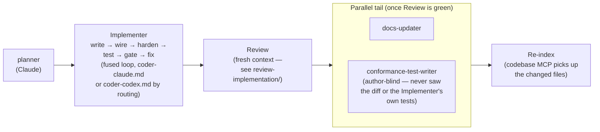

# Implementation Workflow

Automated pipeline that takes a task from specification to verified, documented,
re-indexed code. Four roles, not eighteen steps.

## Pipeline

`orchestrator-quick.md` is the fast-path variant of the same shape for small/low-risk
changes — fewer gates, same quality bar — dispatched by `/implement-quick`.

1. **planner** — Analyzes the codebase, identifies affected files, produces a numbered plan.
2. **Implementer** — the fused generative loop in ONE context: writes the code, wires
   every layer, hardens error paths, writes unit + integration tests, runs them, runs the
   deterministic quality gate (`.claude/scripts/quality-gate.sh`: rustfmt check + clippy
   `-D warnings`), and fixes every failure and finding — looping until tests AND the gate
   are green. `bash .claude/scripts/routing.sh implementation` picks the engine:
   `claude` (the default, decision 148655d9) dispatches **`coder-claude.md`** (agent
   `impl-coder-claude`, Opus); `codex` dispatches **`coder-codex.md`** (agent
   `impl-coder-codex`, `codex-companion.mjs task --json --write`). Either way the context
   reading a failure is the one that wrote the code. `implementer.md` is the canonical
   envelope: `coder-claude.md` follows it directly, `coder-codex.md` forwards it to Codex.
   **UI Implementer** (`coder-ui.md`, agent `impl-coder-ui`, Opus) takes design-heavy web UI
   instead: same fused loop with the site's build/test commands, the frontend-design skill,
   and a required browser check against the named design reference.
3. **Review (fresh context)** — when omp is ready or the diff is high-risk, run the
   review block: Claude comprehensive reviewer ‖ `codex review` ‖ omp (via glen), each blind to the others, folded by the
   Claude **synthesizer** into one dedup'd, provenance-labelled report + ordered fix
   plan (the `/review-implementation` machinery; never sees the Implementer's transcript).
   A skipped omp probe is recorded with its reason; low-risk diffs with a skipped
   probe use the lean Claude ‖ Codex gate instead.
4. **parallel tail** — once Review is green: **docs-updater** updates docs from the
   landed code, ‖ **conformance-test-writer** runs the author-blind, plan-derived
   conformance gate (the anti-reward-hacking check).
5. **re-index** — fold the new/changed files back into the codebase MCP so semantic
   search reflects the merged code (pipeline tail + pre-push hook backstop).

## Which engine runs the fused Implementer

The routed Implementer (`routing.sh implementation`) writes all product code; the host
session never does. Two cases go elsewhere: design-heavy UI (`site/`, landing pages, web
(non-Rust) visual components) goes to the agent `routing.sh ui` names, a Claude Opus
Implementer (`orchestrator.md` → UI implementation routing; `coder-ui.md`); integrating two
already-reviewed parallel waves goes to the engine `routing.sh integration` names (Claude),
followed by the gate, tests and a scoped Claude ‖ Codex review (`orchestrator.md` → Role 1;
`loop-procedures.md` → "Shared seams"). The fused write→wire→harden→test→gate→fix loop runs in **Claude** via `coder-claude.md`
by default, or in **Codex** via `coder-codex.md` (`codex-companion.mjs task --json --write`)
when routing says `codex`; both carry the `implementer.md` envelope + the repo-root
`AGENTS.md` conventions. The
former per-concern agents (`coder.md`, `wiring.md`, `error-handling.md`,
`test-writer.md`, `test-runner.md`, `verifier.md`, `code-simplifier.md`) were fused
into that single loop and **deleted** — do not re-create them.

## Usage

**Entry point:** `/implement` slash command, or read `orchestrator.md` directly.

The orchestrator runs in the main Claude session and dispatches each role as a
subagent via the Agent tool. Specialists cannot spawn other subagents. Large work is
split at slice boundaries (a fresh Implementer per slice/wave), never mid-loop — the
handoff is `progress.md` + the plan's `<task>` XML, never a transcript.

## Engines

Roles come from `.claude/routing.json` through `.claude/scripts/routing.sh`. Today
(decision 148655d9) Role 1 runs in Claude (`coder-claude.md`); it runs in Codex
(`coder-codex.md`) only when `routing.sh implementation` prints `codex`. Codex is one engine
of the Review gate (`codex review` / `codex:codex-rescue`, see `.claude/skills/codex/SKILL.md`).
The planner, Review synthesizer, the parallel tail (docs-updater ‖ conformance-test-writer),
and re-index are Claude subagents on the main-loop model (Fable 5, then Opus). Only the
routed Implementer writes product code.
