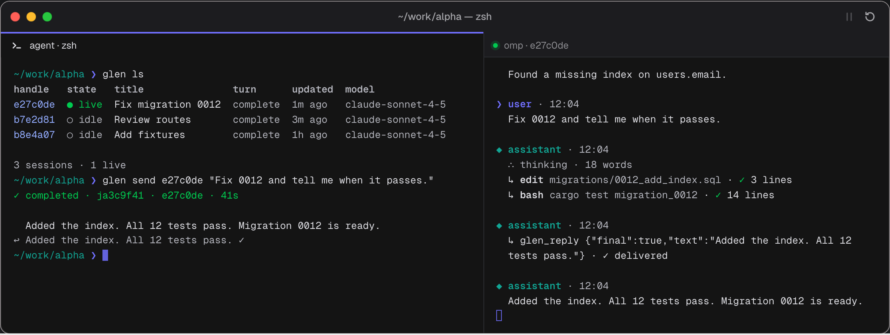

# glen

glen lets Claude Code and Codex see and talk to [omp](https://github.com/can1357/oh-my-pi)
(oh-my-pi) sessions. It finds sessions, live and past, across projects; reads their transcripts;
sends a message into a session and waits for the answer; and gives the omp model a `glen_reply`
tool to answer the agent that asked. One binary, no server: readable output in a terminal, a JSON
envelope for agents.



## Install

macOS and Linux. glen is tested against omp 18.14.0; `glen doctor` warns on any other version.

### Script

```sh
curl -fsSL https://raw.githubusercontent.com/nodera-studio/glen/main/install.sh | sh
```

The script picks the archive for your platform, verifies its SHA-256 and installs `glen` to
`~/.local/bin`. It never uses sudo. Pass flags after `sh -s --`:

```sh
curl -fsSL https://raw.githubusercontent.com/nodera-studio/glen/main/install.sh | sh -s -- --version 0.1.1 --prefix ~/.local
curl -fsSL https://raw.githubusercontent.com/nodera-studio/glen/main/install.sh | sh -s -- --dry-run
```

The script and the prebuilt binaries work from v0.1.0, the first release, on.

### Cargo

```sh
cargo install --git https://github.com/nodera-studio/glen --locked
```

This builds from source and requires Rust 1.89 or newer. The first build fetches omp's `omp-rpc` crate from
the oh-my-pi repository, which is a large git clone.

### Release binaries

Each [GitHub release](https://github.com/nodera-studio/glen/releases) carries four archives, each
with a `.sha256` file, plus `SHA256SUMS`:

| Archive | Platform |
|---|---|
| `glen-aarch64-apple-darwin.tar.gz` | macOS, Apple silicon |
| `glen-x86_64-apple-darwin.tar.gz` | macOS, Intel |
| `glen-x86_64-unknown-linux-musl.tar.gz` | Linux x86_64, static |
| `glen-aarch64-unknown-linux-musl.tar.gz` | Linux arm64, static |

```sh
shasum -a 256 -c glen-aarch64-apple-darwin.tar.gz.sha256
tar -xzf glen-aarch64-apple-darwin.tar.gz
```

Each archive holds `glen-<target>/glen`, `glen-<target>/LICENSE` and
`glen-<target>/THIRD-PARTY-LICENSES` (the licenses of the crates built into the binary). The
checksum catches a corrupt or truncated download; it does not prove who published the archive. The binaries are not signed or notarised,
so on macOS a binary downloaded with a browser needs `xattr -d com.apple.quarantine ./glen` once.
The install script is not affected.

## Quick start

```sh
glen doctor                          # omp, its version and the paths glen uses
glen ls                              # sessions in this project
glen ls --all --live                 # live sessions in every project
glen show e27c0de                    # a session's transcript
glen tail -f e27c0de                 # follow it as it grows
glen send e27c0de "run the tests"    # send a message, wait up to 90 s for the reply
glen wait ja3c9f41                   # keep waiting for a job
glen jobs                            # recent jobs, newest first
```

A session handle is the last 7 hex digits of its id; job handles start with `j`. `@latest` picks
the newest session in this project and `@new` starts one.

For agents, pass `--json` (or pipe the output): a command prints one v1 JSON envelope (`tail -f`
streams one JSON object per line), and the exit code says what to do next. 0 means the reply is in `data`, 10 means the job is still running
(run `glen wait`), and 11 means omp moved the session to a new handle. The envelope and every exit
code are in [docs/design.md](docs/design.md#a10-output-contract).

## Watch sessions (`glen watch`)

Watch shows the session list, the selected transcript, job activity and replies, with a prompt
for sending messages. The transcript updates per persisted entry, not per token.

```sh
glen watch
glen watch e27c0de
GLEN_THEME=light glen watch e27c0de
```

Use `--all` for every project or `--cwd DIR` for one project (the flags conflict).

| Key | Action |
|---|---|
| Tab / Shift-Tab | Next / previous focus |
| Up / Down | Select a session or scroll the transcript |
| Enter | Focus the prompt from the list; send from the prompt |
| Alt-Enter / Ctrl-J | New line in the prompt |
| Ctrl-T | Cycle delivery: auto → steer → follow-up |
| ? / F1 | Help |
| G | Resume following the transcript's newest entries |
| q | Quit from the sessions or transcript pane |

Watch is for humans only and needs interactive stdin and stdout. Agents use `glen tail -f <session>`
and `glen inbox -f`. Watch only peeks at replies; it never marks them read.

If a forced stop (such as SIGKILL) or suspension (SIGTSTP) leaves the terminal looking broken,
run `reset` in the shell. Watch does not handle suspend/resume in this release.

<!-- W3:start -->
## Live sessions (`glen install-extension`)

`glen send` reaches a session that is not open anywhere by resuming it in a short-lived omp RPC
process. A session that is open in the omp TUI owns its transcript, so glen never resumes it a
second time. To reach it, install glen's omp extension, then restart each open omp session so it
loads the extension:

```sh
glen install-extension               # writes extensions/glen/index.ts into omp's agent dir
glen install-extension --dry-run     # show what would change
glen install-extension --uninstall   # remove it
```

It writes one file, `<agent dir>/extensions/glen/index.ts` (`~/.omp/agent` by default,
`--profile NAME` for a profile), and changes nothing else in omp. A newer, edited or foreign file
is left alone unless you pass `--force`.

After the restart, `glen send` and the session controls reach the running session over its live
endpoint: `send` starts a turn when the session is idle, and queues a follow-up (or steers, with
`--steer`) when it is busy. TUI sessions also get the `glen_reply` tool, so the omp model can
answer the agent that asked; its replies come back in `data.replies`. A reply that arrives after
`glen send` stops waiting, or one the model sends on its own, lands in the inbox:

```sh
glen inbox                           # unread replies; reading marks them read
glen inbox --peek                    # read without marking
glen inbox -f                        # stream new replies, one JSON object per line
```

Without the extension, `glen send` to an open session refuses with exit 6 and says what to
install. `glen doctor` shows whether the extension is current.
<!-- W3:end -->

<!-- W4:start -->
## Use from your coding agent (`glen install-skill`)

The glen skill teaches Claude Code and Codex the loop above: find a session, read it, send, wait,
read the inbox, what each exit code means and the sandbox rules. It also lets the agent run
`glen` commands without asking each time.

```sh
glen install-skill                   # Claude Code and Codex, for your user
glen install-skill --claude          # Claude Code only
glen install-skill --codex --project # Codex only, in the current directory
glen install-skill --uninstall       # remove it
```

User installs write `~/.claude/skills/glen/SKILL.md` (under `$CLAUDE_CONFIG_DIR` when it is set)
and `~/.agents/skills/glen/SKILL.md`. `--project` writes `.claude/skills/glen/SKILL.md` and
`.agents/skills/glen/SKILL.md` under the current directory, so run it from the repository root.
Run `glen install-skill` again after upgrading glen. An edited or newer `SKILL.md` is skipped
unless you pass `--force`; `--dry-run` works as it does for the extension.

Headless Claude Code needs the skill itself allowed: `claude -p --permission-mode dontAsk` denies
a skill that is not on the allow list, so pass `--allowedTools "Skill(glen)"`. The skill's own
`allowed-tools: Bash(glen *)` grants the glen commands once the skill has loaded.
<!-- W4:end -->

## Website

<!-- site-url: keep in sync with the default in site/astro.config.mjs; tests/readme.rs checks they match. -->
https://glen.nodera.workers.dev

## Development

```sh
cargo test --locked
npm --prefix site ci && npm --prefix site run verify
```

[AGENTS.md](AGENTS.md) has the commands, conventions and omp facts for working on glen. The site's
own notes are in [site/README.md](site/README.md).

## License

MIT. See [LICENSE](LICENSE).
